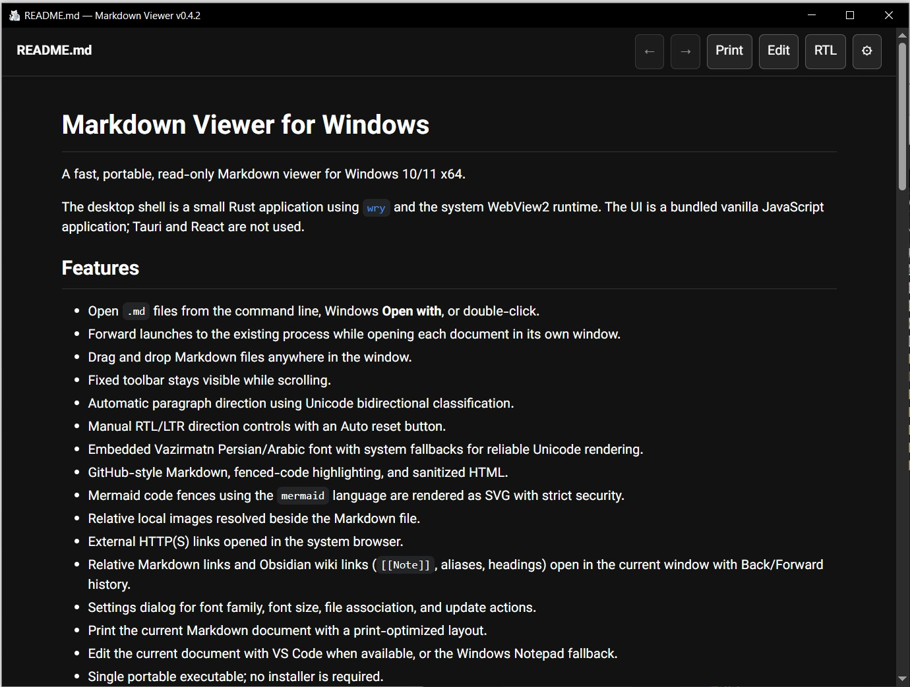

# Markdown Viewer for Windows

A fast, portable, read-only Markdown viewer for Windows 10/11 x64.

The desktop shell is a small Rust application using [`wry`](https://github.com/tauri-apps/wry) and the system WebView2 runtime. The UI is a bundled vanilla JavaScript application; Tauri and React are not used.



## Features

- Open `.md` files from the command line, Windows **Open with**, or double-click.
- Choose Single instance to reuse the active window, or Multiple instances to open each document in a separate window.
- Drag and drop Markdown files anywhere in the window.
- Fixed toolbar stays visible while scrolling.
- Automatic paragraph direction using Unicode bidirectional classification.
- A direction button on the right cycles through Auto, RTL, and LTR and shows the active mode; forced direction also applies to English-first paragraphs and lines.
- Embedded Vazirmatn Persian/Arabic font with system fallbacks for reliable Unicode rendering.
- GitHub-style Markdown, fenced-code highlighting, and sanitized HTML.
- Mermaid code fences using the `mermaid` language are rendered as SVG with strict security.
- Relative local images resolved beside the Markdown file.
- Clickable images open in a keyboard-navigable gallery/lightbox with previous/next controls.
- External HTTP(S) links opened in the system browser.
- Relative Markdown links and Obsidian wiki links (`[[Note]]`, aliases, headings) open in the current window with Back/Forward history.
- Settings dialog for font family, font size, instance mode, file association, and update actions.
- Print the current Markdown document with a print-optimized layout.
- Edit the current document with VS Code when available, or the Windows Notepad fallback.
- Single portable executable; no installer is required.

## Version 0.4.7

- Markdown single newlines now render as visible line breaks, including files with Windows CRLF line endings.

## Version 0.4.6

- Refreshed toolbar with compact controls and the current filename on the left.
- One direction button on the right cycles through Auto, RTL, and LTR and displays the active mode.
- Settings now includes a persistent Single/Multiple instance mode: reuse the active window or open separate document windows.
- Opening another file in Single mode preserves Back/Forward history, and early file-forwarding requests wait for the page to be ready.

## Version 0.4.5

- Forced RTL/LTR now works on paragraphs and individual lines that start with English words.
- Auto, RTL, and LTR have dedicated buttons with a highlighted active mode.
- Local images use the WebView's current origin on Windows, fixing README screenshots and image galleries.

## Version 0.4.4

This release adds local Markdown image rendering with a clickable gallery/lightbox and fixes Windows WebView2 image loading.

## Version 0.4.2

This release embeds the provided Markdown Viewer icon in the Windows executable and uses it for registered `.md` files.

## Version 0.4.1

This release embeds the Vazirmatn Persian font and includes the latest editor, file-association, and drag-and-drop improvements.

## Version 0.4.0

This release adds Mermaid diagrams, Obsidian wiki-link navigation, print support, a fixed toolbar, and a WebView2 startup fix that avoids oversized inline HTML while keeping the portable single-executable distribution.

## Automatic updates

On startup, the viewer checks the latest release in [emadgh/windows-markdown-viewer](https://github.com/emadgh/windows-markdown-viewer). If a newer release exists, it downloads the portable executable in the background and verifies its GitHub SHA-256 digest (or the accompanying `.sha256` asset). The toolbar button changes to **Restart for vX.Y.Z** when the update is ready; clicking it closes the current process, replaces the executable, and launches the new version. No update is applied without that restart action.

Each release must publish these assets with the exact names configured in `webview2-viewer/src/main.rs`:

- `markdown-viewer.exe`
- `markdown-viewer.exe.sha256` (the first whitespace-delimited token is the SHA-256 digest)

## Requirements

- Windows 10 or Windows 11, x64.
- Microsoft Edge WebView2 Runtime. It is normally preinstalled on current Windows versions.
- Node.js/npm and the Rust MSVC toolchain for building from source.

## Build

```powershell
npm ci
npm run build:portable
```

The executable is written to:

```text
webview2-viewer\target\release\markdown-viewer.exe
```

The build script compiles the Vite frontend and embeds the HTML, JavaScript, CSS, and supporting assets into the Rust executable. The `dist/` and Cargo `target/` directories are generated and intentionally ignored by Git.

## Run

Open an empty viewer:

```powershell
.\webview2-viewer\target\release\markdown-viewer.exe
```

Open a document directly:

```powershell
.\webview2-viewer\target\release\markdown-viewer.exe .\README.md
```

You can also drop one or more `.md` files onto any viewer window. A second launch forwards its paths to the running viewer; the selected instance mode determines which window opens them.

## Instance mode

Choose **Settings → Instance mode**:

- **Single instance** (default): the next file opens in the active window, with Back/Forward history. Launching the EXE without a file focuses that window.
- **Multiple instances**: each opened file gets its own window. Launching the EXE without a file opens an empty window.

The preference is saved on your computer and takes effect immediately for double-click and Open with. Existing windows stay open when you change modes. The toolbar shows the current filename on the left. A single button on the right shows the active direction and cycles through **Auto → RTL → LTR → Auto** when clicked.

## File association

The app registers a per-user `MarkdownViewer.md` ProgID when it starts and from the **Set as default .md file viewer** button in Settings. Windows may protect an existing default-app choice. If double-click still opens another application, use:

**Settings → Apps → Default apps → Choose defaults by file type → `.md`**

Then select `markdown-viewer.exe` once.

## Development and tests

Run the frontend development server:

```powershell
npm run dev
```

Run tests:

```powershell
npm test
cargo test --manifest-path webview2-viewer\Cargo.toml
```

With Node.js 22+ and other viewer windows closed, test the built application in WebView2:

```powershell
node scripts/check-webview.mjs .\webview2-viewer\target\release\markdown-viewer.exe
```

This opens the repository README and verifies its screenshot and lightbox, forced RTL/LTR layout, active direction controls, and the Auto reset when opening a new document.

The Rust host validates local Markdown paths, limits document/image sizes, serves relative images through a private protocol, sanitizes bootstrap data, and handles the Windows single-instance forwarding channel.

## Project layout

```text
src/                    Vanilla JS, CSS, and direction logic
scripts/                Frontend bundling/inlining script
tests/                  Frontend tests
webview2-viewer/        Rust + wry Windows host
index.html              Frontend shell
package.json            Vite build and test scripts
```

## License

No license has been selected yet. Add the project license you want before publishing a public package.
